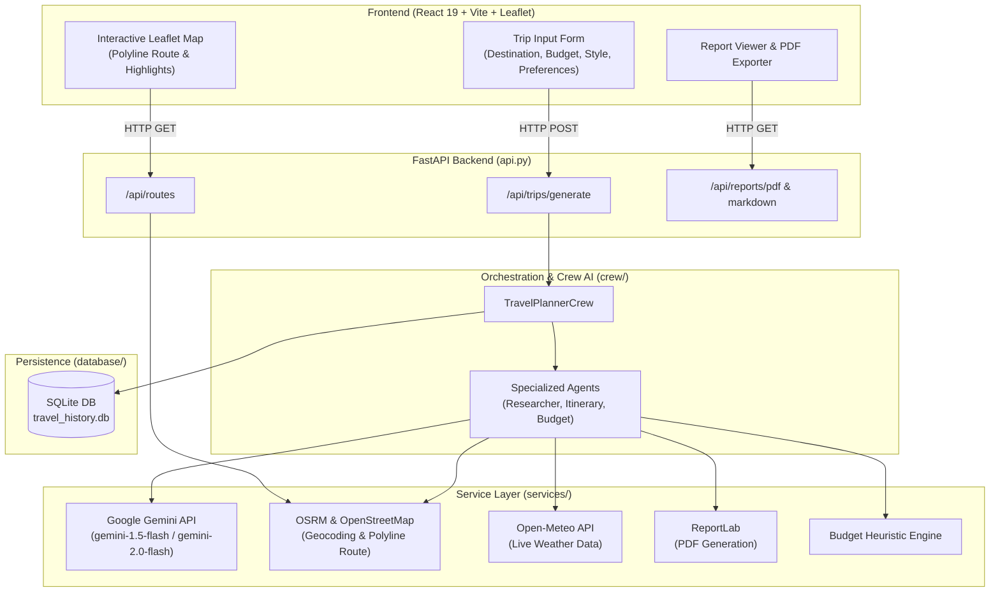

# 🌍 AI Travel Planner

<p align="center">
  
</p>

<p align="center">
  <strong>An intelligent, fullstack multi-agent travel planning platform powered by Google Gemini, Leaflet, and FastAPI.</strong>
</p>

<p align="center">
  <a href="#-quick-start"></a>
  <a href="#-features"></a>
  <a href="#-api-documentation"></a>
  <a href="#-interactive-map--routes"></a>
</p>

<p align="center">
  
  
  
  
  
  
</p>

---

## 📑 Table of Contents

- [✨ Features](#-features)
- [🏗️ System Architecture](#️-system-architecture)
- [🚀 Quick Start](#-quick-start)
  - [1. Backend Setup](#1-backend-setup)
  - [2. Frontend Setup](#2-frontend-setup)
- [🖥️ Command-Line Interface (CLI)](#️-command-line-interface-cli)
- [📡 API Documentation](#-api-documentation)
- [🗺️ Interactive Map & Route Intelligence](#️-interactive-map--route-intelligence)
- [⚙️ Configuration & Environment Variables](#️-configuration--environment-variables)
- [📂 Project Structure](#-project-structure)
- [❓ FAQ & Troubleshooting](#-faq--troubleshooting)
- [🤝 Contributing](#-contributing)
- [📄 License](#-license)

---

## ✨ Features

- [x] **🤖 Gemini AI Itinerary Engine**: Creates day-by-day itineraries, attraction schedules, dining suggestions, and insider tips tailored to custom travel styles (*Budget*, *Standard*, *Luxury*).
- [x] **🗺️ Interactive Route & Waypoint Mapping**: Integrated Leaflet.js map with turn-by-turn directions, en-route attractions, interactive polyline route visualization, and distance/duration calculations via OSRM & OpenStreetMap.
- [x] **🌦️ Real-Time Weather Forecasting**: Fetches live temperature and conditions for destinations via Open-Meteo.
- [x] **💰 Dynamic Budgeting Engine**: Intelligent category-wise budget estimation (accommodation, food, transit, entry fees, and contingency reserve) in Indian Rupees (INR).
- [x] **📄 Instant PDF & Markdown Export**: Clean, printable PDF trip dossiers generated via ReportLab and formatted Markdown summaries ready for offline access.
- [x] **⚡ Fullstack Architecture**: Asynchronous FastAPI backend with auto-generated Swagger UI coupled with a reactive React 19 + Vite frontend.
- [x] **💾 Trip History Persistence**: Lightweight local SQLite database storing your past travel itineraries.

---

## 🏗️ System Architecture



---

## 🚀 Quick Start

### 1. Backend Setup

Ensure you have **Python 3.10+** installed.

```bash
# 1. Clone the repository
git clone https://github.com/viswateja5/AI-Travel-Planner.git
cd AI-Travel-Planner

# 2. Create and activate a virtual environment
python3 -m venv .venv
source .venv/bin/activate    # On Windows: .venv\Scripts\activate

# 3. Install backend dependencies
pip install -r requirements.txt

# 4. Configure environment variables
cp .env.example .env
```

Open `.env` and configure your Google Gemini API key:
```env
GEMINI_API_KEY=your_gemini_api_key_here
GEMINI_MODEL=gemini-1.5-flash
DEFAULT_CURRENCY=INR
```

Run the backend server:
```bash
uvicorn api:app --reload --host 127.0.0.1 --port 8000
```
> The API will be live at `http://127.0.0.1:8000`. You can test endpoints via Swagger UI at `http://127.0.0.1:8000/docs`.

---

### 2. Frontend Setup

In a new terminal window:

```bash
# Navigate to the frontend directory
cd frontend

# Install dependencies
npm install

# Start development server
npm run dev
```

Visit `http://localhost:5173` in your browser to start planning trips interactively!

---

## 🖥️ Command-Line Interface (CLI)

You can also run the travel planner entirely from your terminal without launching the frontend or web server:

```bash
python main.py \
  --start "Bangalore" \
  --destination "Mysore" \
  --days 3 \
  --budget 15000 \
  --travelers 2 \
  --travel-style "standard" \
  --travel-mode "driving" \
  --preferences "heritage sites, local food, nature"
```

<details>
<summary><strong>🔍 Click to view CLI Options Reference</strong></summary>

| Argument | Type | Default | Description |
| :--- | :--- | :--- | :--- |
| `--start` | String | `""` | Departure city or starting point |
| `--destination` | String | *Required* | Target travel destination |
| `--days` | Integer | `3` | Trip length in days (1 to 30) |
| `--budget` | Float | `1200.0` | Total budget for the trip in INR |
| `--travelers` | Integer | `2` | Number of travelers |
| `--travel-style` | Choice | `standard` | `budget`, `standard`, or `luxury` |
| `--travel-mode` | Choice | `driving` | `driving`, `public_transport`, `walking`, `cycling`, `flight`, `best_available` |
| `--currency` | Choice | `INR` | Currency format |
| `--preferences` | String | `balanced` | Custom traveler interests (e.g. `temples, street food, relaxing`) |

</details>

---

## 📡 API Documentation

Once the backend is running, explore the interactive documentation:
- **Swagger UI**: [http://127.0.0.1:8000/docs](http://127.0.0.1:8000/docs)
- **ReDoc**: [http://127.0.0.1:8000/redoc](http://127.0.0.1:8000/redoc)

<details>
<summary><strong>🔌 Click to explore Key Endpoints & JSON Payloads</strong></summary>

### 1. `POST /api/trips/generate`
Generates a complete multi-day itinerary with weather, routes, and budget estimates.

**Request Body:**
```json
{
  "start": "Bangalore",
  "destination": "Ooty",
  "days": 3,
  "budget": 20000,
  "travelers": 2,
  "travel_style": "standard",
  "travel_mode": "driving",
  "currency": "INR",
  "preferences": "botanical gardens, tea estates, scenic drives"
}
```

**Response Example:**
```json
{
  "success": true,
  "destination": "Ooty",
  "trip": { ... },
  "result": "# 3-Day Ooty Travel Plan\n\n### Day 1: Botanical Splendor...",
  "markdown_available": true,
  "pdf_available": true,
  "pdf_url": "/api/reports/pdf",
  "markdown_url": "/api/reports/markdown",
  "budget_breakdown": {
    "total": 20000,
    "stay": 8000,
    "food": 5000,
    "travel": 4000,
    "activities": 2000,
    "buffer": 1000
  }
}
```

---

### 2. `GET /api/routes`
Retrieves routing geometry, distance, duration, and transit recommendations.

```bash
curl "http://127.0.0.1:8000/api/routes?start=Bangalore&destination=Mysore&mode=driving"
```

---

### 3. `GET /api/reports/pdf`
Streams the generated formatted PDF dossier (`travel_plan.pdf`) directly to the browser for instant download.

</details>

---

## 🗺️ Interactive Map & Route Intelligence

The frontend includes an interactive **React-Leaflet** map featuring:
- 📍 **Start & End Pinpoint Markers**: Color-coded waypoints identifying your departure and arrival stations.
- 🛣️ **Turn-by-Turn Path**: Real polyline paths plotted directly onto OpenStreetMap tiles.
- 🏛️ **En-Route Places of Interest**: Automatically discovers notable stops, heritage spots, and food breaks along the transit corridor.
- 🎯 **Destination Highlights**: Popups showcasing recommended attractions right inside the map interface.

---

## ⚙️ Configuration & Environment Variables

| Variable | Default Value | Description |
| :--- | :--- | :--- |
| `GEMINI_API_KEY` | *(Required)* | Your Google Gemini API Key from Google AI Studio |
| `GEMINI_MODEL` | `gemini-1.5-flash` | Supported: `gemini-1.5-flash`, `gemini-2.0-flash`, `gemini-3.5-flash-lite` |
| `GEMINI_TIMEOUT_SECONDS`| `60` | Request timeout for Gemini inference |
| `DEFAULT_CURRENCY` | `INR` | Budget currency symbol and calculations |
| `DEFAULT_BUDGET_MODE` | `heuristic` | Algorithm used for budget breakdown |
| `ENABLE_TRIP_HISTORY` | `true` | Enables logging generated trips to SQLite database |

---

## 📂 Project Structure

```text
AI-Travel-Planner/
├── api.py                    # FastAPI server & route handlers
├── config.py                 # Centralized configuration & environment loader
├── main.py                   # CLI entrypoint
├── requirements.txt          # Python dependencies
├── .env.example              # Sample environment template
│
├── crew/                     # Crew orchestration logic
│   ├── agents.py             # Agent definitions & personas
│   ├── crew.py               # Main workflow coordinator
│   ├── tasks.py              # Task definitions for research & drafting
│   └── tools.py              # Tool bindings for crew execution
│
├── services/                 # Modular service layer
│   ├── gemini_service.py     # Gemini LLM connector
│   ├── location_service.py   # Nominatim / OpenStreetMap geocoder
│   ├── maps_service.py       # OSRM router & nearby place finder
│   ├── weather_service.py    # Open-Meteo live weather client
│   ├── budget_service.py     # Cost estimation & breakdown engine
│   ├── pdf_service.py        # ReportLab PDF generator
│   └── markdown_service.py   # Markdown exporter
│
├── database/                 # Persistence layer
│   ├── database.py           # SQLite trip history store
│   └── models.py             # Data schemas
│
├── frontend/                 # Vite + React 19 Frontend
│   ├── src/
│   │   ├── App.jsx           # Main application interface with Leaflet map
│   │   ├── App.css           # Styling & responsive design
│   │   └── main.jsx          # React DOM bootstrap
│   ├── package.json          # Node dependencies
│   └── vite.config.js        # Vite bundler configuration
│
└── tests/                    # Integration and unit tests
    └── test_backend_services.py
```

---

## ❓ FAQ & Troubleshooting

<details>
<summary><strong>Q: Where do I get a Google Gemini API Key?</strong></summary>
You can obtain a free API key by visiting <a href="https://aistudio.google.com/">Google AI Studio</a>. Add the key to your <code>.env</code> file under <code>GEMINI_API_KEY</code>.
</details>

<details>
<summary><strong>Q: What happens if an API key is missing?</strong></summary>
The planner handles missing or invalid keys gracefully with diagnostic warnings, explaining how to configure your <code>.env</code> file.
</details>

<details>
<summary><strong>Q: Can I use travel modes other than driving?</strong></summary>
Yes! The system supports <code>driving</code>, <code>public_transport</code>, <code>walking</code>, <code>cycling</code>, <code>flight</code>, and <code>best_available</code> modes.
</details>

<details>
<summary><strong>Q: Where are the generated travel plans stored?</strong></summary>
Generated plans are written to the <code>outputs/</code> directory:
<ul>
  <li><code>outputs/travel_plan.md</code>: Markdown format</li>
  <li><code>outputs/travel_plan.pdf</code>: PDF document</li>
</ul>
</details>

---

## 🤝 Contributing

Contributions, issues, and feature requests are welcome!

1. Fork the Project
2. Create your Feature Branch (`git checkout -b feature/AmazingFeature`)
3. Commit your Changes (`git commit -m 'Add some AmazingFeature'`)
4. Push to the Branch (`git push origin feature/AmazingFeature`)
5. Open a Pull Request

---

## 📄 License

Distributed under the **MIT License**. See `LICENSE` for more information.
